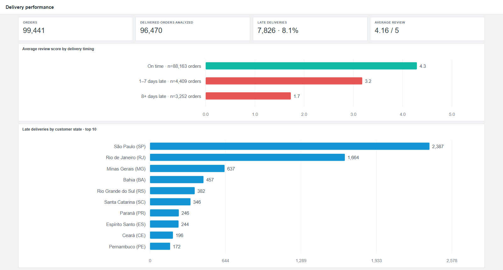
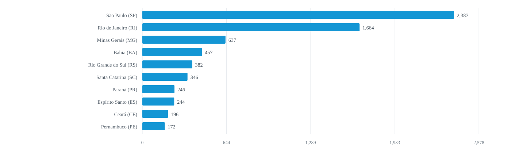

# E-commerce Delivery and Customer Reviews

## 1. Key Question

Do late deliveries get lower reviews, and which states have the most late deliveries?

## 2. Key Problem

Late deliveries can hurt a customer's experience. The business needs to know whether late orders get lower reviews and where late deliveries are most common.

## 3. Key Analysis

- Compare average review scores for orders delivered on time, 1–7 days late, and 8 or more days late.
- Count late deliveries by customer state to show where the business has the most delayed orders.
- Use one row per order in the analysis. If an order has more than one review, average its scores before joining the tables.

## 4. Summary

The analysis includes **96,470 delivered orders** with both delivery dates. **7,826 (8.1%)** arrived after the estimated date. Average review scores were **4.29** for on-time deliveries, **3.18** for deliveries 1–7 days late, and **1.73** for deliveries 8 or more days late.

São Paulo had the most late deliveries (**2,387**), followed by Rio de Janeiro (**1,664**). Late deliveries and lower reviews appear together in this data; this does not prove that a delay caused a low review.

## Dashboard Preview



[Open the dashboard](reports/dashboard.html)

## Data

- **Dataset:** [Brazilian E-Commerce Public Dataset by Olist on Kaggle](https://www.kaggle.com/datasets/olistbr/brazilian-ecommerce)
- **Download:** Run `python src/download_data.py` to download the Kaggle archive and keep the three CSV files used here.
- **Tables used:** `olist_orders_dataset.csv`, `olist_customers_dataset.csv`, and `olist_order_reviews_dataset.csv`. See [data/README.md](data/README.md) for what all nine Kaggle tables contain.
- **Join:** Match orders to customers with `customer_id`, then match reviews to orders with `order_id`.
- **Rows analyzed:** One delivered order per row. Orders without an actual or estimated delivery date are left out. Review scores are averaged by order before the join, so an order is counted once.

| Table | Fields used | What they mean |
|---|---|---|
| `orders` | `order_id` | Order number |
| `orders` | `customer_id` | Customer number for this order |
| `orders` | `order_status` | Order status |
| `orders` | `order_delivered_customer_date` | Date the customer received the order |
| `orders` | `order_estimated_delivery_date` | Estimated delivery date |
| `customers` | `customer_id` | Customer number used to join the tables |
| `customers` | `customer_state` | Customer's state in Brazil |
| `order_reviews` | `order_id` | Order number linked to the review |
| `order_reviews` | `review_score` | Customer rating from 1 to 5 |

## Dashboard Charts

The README images below are the same charts shown in the dashboard. Each caption describes the numbers shown and points to the SQL in [`sql/analysis.sql`](sql/analysis.sql).

### Average review score by delivery timing


*Average rating from 1 to 5 for on-time, 1–7 day late, and 8+ day late orders. The labels show how many reviewed orders are in each group · SQL Q2*

### Late deliveries by customer state



*Number of delivered orders that arrived after the estimated date in the ten states with the most late deliveries · SQL Q3*

## Run the project

From this project folder, run:

```powershell
python src/download_data.py
python src/analyze.py
```

This rebuilds the dashboard, chart images, and `outputs/summary.json`. Open [`reports/dashboard.html`](reports/dashboard.html) in a browser to view it offline.

To run the SQL, install DuckDB and run:

```powershell
duckdb -c ".read sql/analysis.sql"
```
